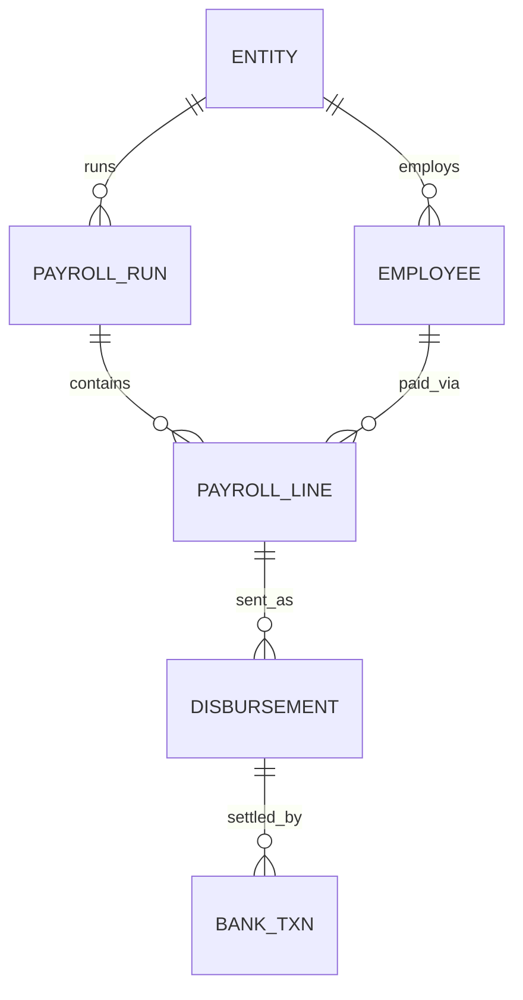

# Financial Data Quality & Reconciliation Platform

Synthetic payroll, disbursement and bank-settlement data, reconciled end to end with PostgreSQL, dbt and Power BI.

> **Status:** work in progress. All data is synthetic. No employer or real customer data is used anywhere in this repo.

## Problem

Finance teams need to confirm that what payroll said to pay, what was actually sent, and what the bank settled all agree. When they don't, someone has to find out which payments are wrong, why, and how many.

## Questions this project answers

- Which payments are missing, duplicated, mismatched, late or failed?
- How healthy is reconciliation overall, by entity and by pay period?
- Can every exception be traced back to a single record?

## Architecture

Python generator → PostgreSQL (`raw`) → dbt (`staging`, `marts`) → Power BI

## Data model



`BANK_TXN.disbursement_id` is nullable on purpose. A bank transaction with no matching disbursement is an orphan.

## Planted issues

The generator plants known issues at fixed rates and records them in `truth.planted_issues`, so the dbt exception logic can be validated against ground truth.

| Issue | Meaning |
|---|---|
| `missing_disbursement` | A payroll line with no disbursement at all |
| `duplicate_disbursement` | The same payroll line paid twice |
| `amount_mismatch` | Amount sent differs from the amount payroll expected |
| `late_settlement` | Settled more than 3 days after sending |
| `failed_no_retry` | Bank transaction failed and was never retried |
| `orphan_bank_txn` | Bank transaction with no matching disbursement |

Failed transactions that are retried successfully are generated as normal noise and are not counted as issues.

## Repository structure

```
generate_data.py      synthetic data generator (writes raw.* and truth.planted_issues)
docker-compose.yml    local PostgreSQL 16
setup_staging.sh      scaffolds the dbt sources, staging models and tests
recon_dbt/            dbt project (staging models and tests; marts coming)
requirements.txt      Python dependencies
```

## How to run

Prerequisites: Python 3.12 or newer, and Docker.

```bash
# 1. Python environment (Windows Git Bash; on macOS/Linux use .venv/bin/activate)
python -m venv .venv
source .venv/Scripts/activate
pip install -r requirements.txt

# 2. Database
docker compose up -d
docker compose exec -T db psql -U recon -d recon_platform -c "CREATE SCHEMA IF NOT EXISTS staging; CREATE SCHEMA IF NOT EXISTS marts;"

# 3. Synthetic data (about 150,000 raw rows)
python generate_data.py
```

dbt reads its connection from `~/.dbt/profiles.yml`. Create it with:

```yaml
recon_dbt:
  target: dev
  outputs:
    dev:
      type: postgres
      host: localhost
      port: 5433
      user: recon
      password: recon_dev
      dbname: recon_platform
      schema: staging
      threads: 4
```

Then build and test the models:

```bash
cd recon_dbt
dbt build
```

The password above is a throwaway for a local, synthetic database.

## Success criteria

- Every planted issue is detected by the dbt exception logic.
- Every exception traces back to a record.
- `dbt build` passes with all tests green.

## Roadmap

- [x] Synthetic data generator with planted issues
- [ ] Staging models and tests (tick when `dbt build` passes)
- [ ] Reconciliation mart
- [ ] Exception detection validated against `truth.planted_issues`
- [ ] Power BI dashboard
- [ ] Case study write-up
