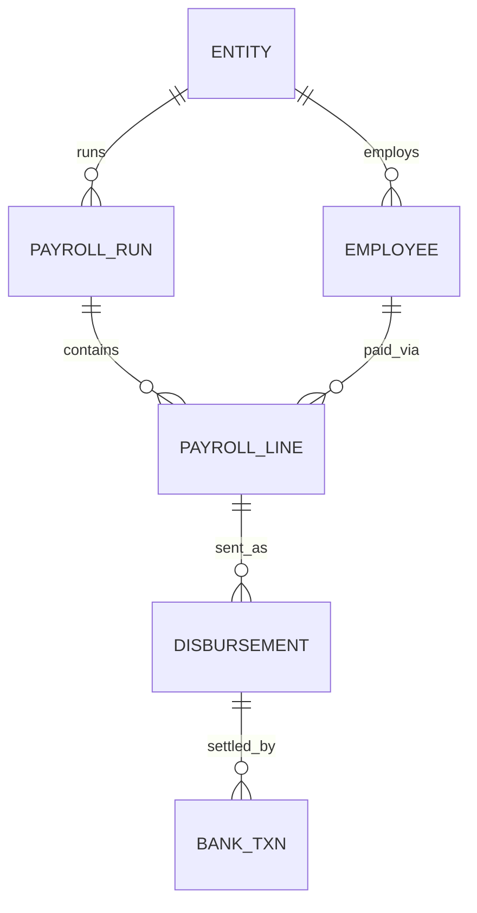

# Financial Data Quality & Reconciliation Platform

Synthetic payroll, disbursement and bank-settlement data, reconciled end to end with PostgreSQL, dbt and Power BI. A validation layer proves the exception logic against known ground truth.

> All data is synthetic. No employer or real customer data is used anywhere in this repo.


## Problem

Finance and operations teams need to confirm that what payroll said to pay, what was actually sent, and what the bank settled all agree. When they don't, someone has to find out which payments are wrong, why, how much money is at stake, and whether the checks can be trusted.

## What it does

- Generates about 150,000 rows of realistic payroll, disbursement and bank data, with six kinds of problems planted at known rates.
- Reconciles every payroll line against its disbursements and bank settlements.
- Classifies each problem as an exception that traces to a single record.
- Validates the detection logic against the planted ground truth.
- Serves the results to a Power BI dashboard.

## Results

| Measure | Value |
|---|---|
| Payroll lines reconciled | 48,000 |
| Lines with no exception | 45,344 (94.47%) |
| Exceptions detected | 2,801 |
| Synthetic exposure at stake | about 258M |
| Planted issues detected | 2,801 of 2,801 (100% recall, 0 false alarms) |

Detection scorecard (`marts.qa_detection_scorecard`):

| Issue | Planted | Detected | Missed | False alarms |
|---|---|---|---|---|
| late_settlement | 693 | 693 | 0 | 0 |
| amount_mismatch | 566 | 566 | 0 | 0 |
| failed_no_retry | 516 | 516 | 0 | 0 |
| missing_disbursement | 495 | 495 | 0 | 0 |
| duplicate_disbursement | 386 | 386 | 0 | 0 |
| orphan_bank_txn | 145 | 145 | 0 | 0 |

Real data is messier than planted data, so these numbers show that the logic matches its own rules, not that it would score 100% in production.

## Architecture

Python generator → PostgreSQL (`raw`, `truth`) → dbt (`staging` → `intermediate` → `marts`) → Power BI


## Data model



`BANK_TXN.disbursement_id` is nullable on purpose. A bank transaction with no matching disbursement is an orphan.

## Business rules

| Issue | Rule |
|---|---|
| `missing_disbursement` | A payroll line with no disbursement |
| `duplicate_disbursement` | A payroll line with more than one disbursement |
| `amount_mismatch` | Amount sent differs from the amount payroll expected |
| `late_settlement` | Settled, never failed, and settled more than 3 days after sending (`settlement_sla_days`) |
| `failed_no_retry` | Every bank attempt failed and none settled |
| `orphan_bank_txn` | Bank transaction with no matching disbursement |

A payment that failed and was then retried successfully is classed `reconciled_after_retry`. Its delay is explained by the retry, so it is not counted as late.

Exposure amount: overpayment for duplicates, the absolute difference for mismatches, and the expected payment for missing, late and failed payments.

## Data quality and validation

`dbt build` runs 13 models and 39 tests:

- Key, relationship and accepted-value tests on every layer.
- `assert_recon_covers_every_line`: the reconciliation table has exactly one row per payroll line.
- `assert_all_planted_issues_detected`: fails if any planted issue is missed or any false alarm appears.

## Dashboard

Three pages: executive overview, exception investigation, and detection validation.

**Exception investigation**: where the money at stake sits, down to a single record.


**Detection validation**: what the dbt logic detected compared with what the generator planted.


## Repository structure

```
generate_data.py      synthetic data generator (writes raw.* and truth.planted_issues)
docker-compose.yml    local PostgreSQL 16
setup_staging.sh      scaffolds the dbt sources, staging models and tests
setup_marts.sh        scaffolds the intermediate and marts layers and validation tests
recon_dbt/            dbt project
requirements.txt      Python dependencies
docs/images/          screenshots used in this README
powerbi/              Power BI dashboard file (recon_dashboard.pbix)
```

## How to run

Prerequisites: Python 3.12 or newer, and Docker.

```bash
# 1. Python environment (Windows Git Bash; on macOS/Linux use .venv/bin/activate)
python -m venv .venv
source .venv/Scripts/activate
pip install -r requirements.txt

# 2. Database
docker compose up -d

# 3. Synthetic data (about 150,000 raw rows)
python generate_data.py
```

dbt reads its connection from `~/.dbt/profiles.yml`:

```yaml
recon_dbt:
  target: dev
  outputs:
    dev:
      type: postgres
      host: localhost
      port: 5433
      user: recon
      password: recon_dev
      dbname: recon_platform
      schema: staging
      threads: 4
```

Then build and test everything:

```bash
cd recon_dbt
dbt build
```

Expected: `PASS=52 WARN=0 ERROR=0`. The password above is a throwaway for a local, synthetic database.

## Limitations and next steps

- The data is synthetic and cleaner than production data. Real data brings late-arriving records, partial files and ambiguous matches.
- Everything runs in full each time. A production version would use incremental models and an orchestrator (for example Airflow or dbt Cloud).
- Next steps: alerting on exceptions, an exception ageing and resolution workflow, and fuzzy matching for orphan bank transactions.
